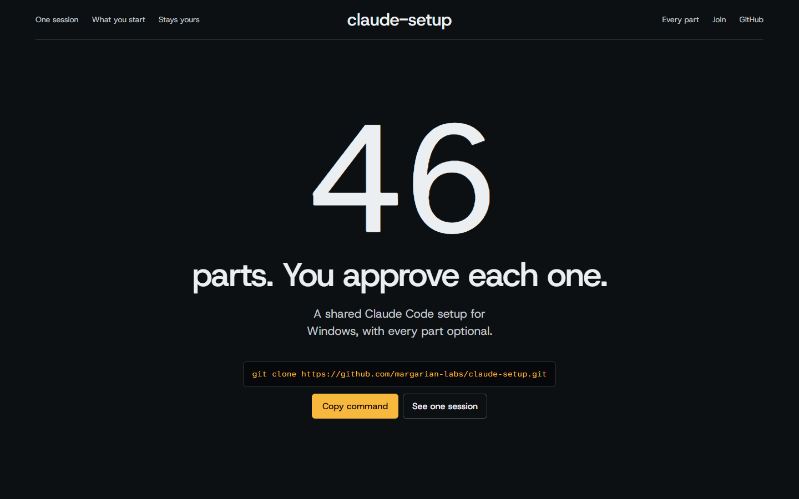

<div align="center">

# claude-setup

A shared Claude Code setup for Windows.<br>You approve every change and can undo any.

<a href="https://margarian-labs.github.io/claude-setup/"></a>

### [Open the demo page](https://margarian-labs.github.io/claude-setup/)

See what each part does during a session, what you can start yourself and what it costs.

[](LICENSE) [](#quick-start) [](https://github.com/margarian-labs/claude-setup/tags)

[Quick start](#quick-start) · [How it works](#how-it-works) · [What you get](#what-you-get) · [Safety](#safety)

</div>

## How it works

| 1. Join | 2. Stay up to date | 3. Go back |
| --- | --- | --- |
| Clone this repo and say **Follow START.md**. Your agent checks your PC, backs up your current setup and asks about each part on its own: what it is, what it solves, its use cases, what it changes on your PC and what it costs. | Say **sync my setup**. Each new change comes as a proposal: what and why, token cost, how well it was tested, what it runs and the real diff. You answer accept, skip or later. Nothing updates in the background. | Say **roll back my last sync** or **go back to version v2026.11.23.1**. Only what sync wrote is restored; your own files, settings and edits stay. Rolled-back changes are offered again on the next sync. |

## Quick start

> [!TIP]
> You need Windows, Git for Windows (Git Bash), Node 18 or newer and Claude Code. No GitHub account is needed.

1. Clone the repo anywhere:
   ```
   git clone https://github.com/margarian-labs/claude-setup.git
   ```
2. Open Claude Code in the clone and say **Follow START.md**. Your agent installs the sync skill and walks you through the rest.

## Safety

> [!NOTE]
> - Only the owner can change this repo; anyone can read it.
> - Every script, hook and settings change is shown as a real diff before you accept it. Risky settings (environment, permissions, hooks, MCP servers) need a typed confirmation.
> - No secrets live here: keys stay in your own environment variables or local files.

## What you get

Every part is optional. Recommended parts are ticked in the first-run menu and optional ones are not. A part your PC can't run (for example, one that needs Node or a second Claude account) is hidden.

<!-- catalog:start -->
### Works on its own

Once installed, these work in every session without you doing anything.

<details>
<summary><b>Rules</b> · 4 parts</summary>

- **Core rules** `recommended`<br>Short answers, honest pushback, no long dashes and readable pages. Loaded every session.
- **Style and coding rules** `recommended`<br>Coding conventions and git habits, plus a PR description format. Loaded every session.
- **Sub-agents and model roles** `recommended`<br>Opus leads, Fable plans, Sonnet and Haiku do the work from detailed briefs, and Opus checks every result.
- **Workflow rules** `recommended`<br>How Claude works day to day: plan mode for bigger tasks, picking skills itself, editing over creating, questions through AskUserQuestion.

</details>

<details>
<summary><b>Settings</b> · 10 parts</summary>

- **Auto-compact at 600k** `recommended`<br>Compacts the conversation automatically at 600k tokens. Needs a model with a 1M context window.
- **Basics** `recommended`<br>UTF-8 for Python and no session cron jobs.
- **Bypass mode** `recommended`<br>Claude runs every command and edit without asking. Prompt-free agents and away mode depend on it.
- **Fullscreen display** `recommended`<br>Uses the fullscreen terminal interface.
- **Housekeeping** `optional`<br>Keeps sessions 365 days, starts worktrees from a fresh branch, turns workflows and autoDream off.
- **Messages between local sessions** `recommended`<br>Other Claude sessions on this PC can message this one, used by handoffs and setup-change notices.
- **Models and effort** `recommended`<br>Opus as main model, Sonnet for workers, effort set per model. Check first that your plan includes Fable 5.2.
- **Remote Control at startup** `recommended`<br>Every session can be reached from the Claude app on your phone or another computer.
- **Skill overrides** `recommended`<br>Turns off 3 noisy skills and sets 5 built-in ones to run only when you ask for them.
- **Status line** `recommended`<br>Shows account, model, effort, context, usage limits and folder, and writes the usage files that away mode reads.

</details>

<details>
<summary><b>Workflow</b> · 1 part</summary>

- **Compaction recovery** `recommended`<br>After a compaction, points Claude to the full transcript and to your exact words, so nothing important is lost.

</details>

<details>
<summary><b>Hooks</b> · 2 parts</summary>

- **Session id** `recommended`<br>Shows the session id when a session starts, so you can name it in handoffs and messages.
- **Session namer** `recommended`<br>Names each session with a short project key and title, such as "WEB fix login".

</details>

<details>
<summary><b>Agents</b> · 1 part</summary>

- **Planner, second opinion and Haiku worker** `recommended`<br>Three helper agents: a planner for big tasks, a second opinion for hard calls, and a Haiku worker for simple jobs.

</details>

<details>
<summary><b>Skills</b> · 14 parts</summary>

- **Conversion rate optimization** `recommended`<br>Finds what to change on a landing, pricing or form page to get more conversions, and why it is not converting.
- **Deprecation and migration** `recommended`<br>Plans the safe removal or replacement of old systems and APIs, including database changes with no downtime.
- **Design system file** `recommended`<br>Gives a new project a design system by writing a DESIGN.md based on one of 84 well known product brands.
- **Diagram craft** `recommended`<br>Helps you draw diagrams by hand: picks the right type and keeps nodes, lines and labels readable and accurate.
- **Domain modeling** `recommended`<br>Builds and sharpens a project's domain model via glossary terms and architecture decision records.
- **Grilling** `recommended`<br>Interviews you in rounds of questions until a plan, design or decision has nothing left assumed.
- **Hallmark** `recommended`<br>Makes websites and landing pages look made, not generated; can also redesign or audit an existing page.
- **Liteparse** `recommended`<br>Local OCR and text extraction for scanned, image-only or long PDFs, so you need not read pages as images.
- **Plain writing** `recommended`<br>Cleans prose other people will read: removes AI writing tells and checks that no fact was lost.
- **Prototype** `recommended`<br>Builds a throwaway prototype to sanity-check a state model or explore what a UI should look like.
- **Research** `recommended`<br>Researches a question against primary sources with a background agent and saves the findings as a repo Markdown file.
- **UI craft** `recommended`<br>Rules for making app screens, dashboards, forms and sites look designed rather than AI-generated, plus a redesign audit.
- **UI/UX Pro Max** `recommended`<br>Searches a local design database when you pick UI styles, colour palettes, font pairings, chart types or UX rules.
- **Video analysis** `recommended`<br>Looks at frames from a video or screen recording and transcribes speech so you learn what happens and what is said.

</details>

<details>
<summary><b>Plugins</b> · 3 parts</summary>

- **Playwright plugin** `recommended`<br>Lets Claude drive a real browser: open pages, click, fill forms and take screenshots.
- **Skill creator plugin** `optional`<br>Helps write, test and improve your own skills.
- **Superpowers plugin** `recommended`<br>Skills for planning, debugging, code review, worktrees and proving work before calling it done.

</details>

<details>
<summary><b>Tools</b> · 2 parts</summary>

- **Disk Watchdog** `optional`<br>A background check every 10 minutes that shrinks huge Claude temp logs and cleans old session temp and old backups.
- **Tidy** `recommended`<br>At the end of a task, finds what the session left behind and removes only its own throwaway files.

</details>

<details>
<summary><b>Integrations</b> · 2 parts</summary>

- **memohopper memory** `optional`<br>Connects the memohopper memory service and adds rules to use it as primary memory, with tasks.
- **Telegram notifications** `optional`<br>Phone messages through your own Telegram bot when Claude finishes, needs input or asks a question.

</details>

<details>
<summary><b>Lessons</b> · 1 part</summary>

- **Lessons** `optional`<br>Seven short notes from real mistakes (settings, hooks, Telegram, disk cleanup, prompts, token savings) kept in file memory.

</details>

### You start these

These do nothing until you use them; the line in italics says how.

<details>
<summary><b>Rules</b> · 1 part</summary>

- **Prompt flags** `recommended`<br>Short flags in a message (-d, -w, -nc, -q, -rc, -a, -p, -m, -away) change how Claude handles it.<br>_Add a flag such as -d, -w, -q, -rc, -a, -p or -m at the start or end of your message._

</details>

<details>
<summary><b>Workflow</b> · 2 parts</summary>

- **Away mode** `recommended`<br>Say -away and the agent asks all its questions first, then finishes the whole task without you, with an optional usage stop point.<br>_Add -away (or -away 85 for a weekly usage stop point) to your message; -back ends it._
- **Handoff** `recommended`<br>Writes a full handoff for a fresh session, and suggests one after 2 compactions once the context is 80% full.<br>_Say "write a handoff" (add a session id to pass it on). A hook also suggests one when context gets big._

</details>

<details>
<summary><b>Skills</b> · 1 part</summary>

- **Architecture decisions** `optional`<br>Writes architecture decision records and reviews system designs with trade-offs and consequences.<br>_Type /architecture with the decision or system._

</details>

<details>
<summary><b>Tools</b> · 2 parts</summary>

- **Sync engine** `recommended`<br>The tool and skill that install this setup, bring in updates one by one and roll back. Say "sync my setup" to use it.<br>_Say "sync my setup", "roll back my setup" or "go back to version X"._
- **Usage tools** `optional`<br>Cost and usage reports built from your local Claude transcripts.<br>_Run the report scripts in ~/.claude/tools when you want a cost or usage report._

</details>

<details>
<summary><b>Integrations</b> · 1 part</summary>

- **Multiple Claude accounts** `optional`<br>Keeps multiple Claude accounts signed in on the same PC, with no signing out and in. It sets up two: "claude" and "claude -P".<br>_Type claude -P (or your chosen flag) to start the second account._

</details>
<!-- catalog:end -->

## License

MIT for this repo's own content, see [LICENSE](LICENSE). Bundled third-party skills keep their own licenses, listed in [THIRD-PARTY-NOTICES.md](payload/skills/THIRD-PARTY-NOTICES.md).
