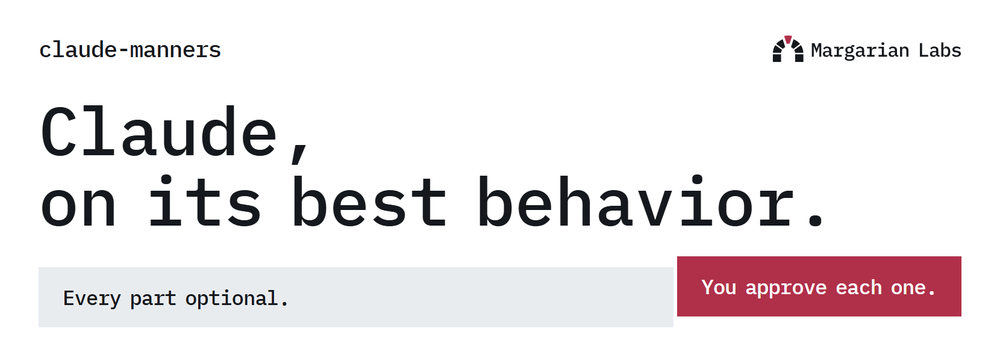

<a href="https://margarian-labs.github.io/claude-manners/"><picture><source media="(prefers-color-scheme: dark)" srcset="docs/banner-dark.png"></picture></a>

<p align="center"><a href="LICENSE"></a> <a href="#quick-start"></a> <a href="https://github.com/margarian-labs/claude-manners/tags"></a></p>

# claude-manners

A shared Claude Code setup for Windows. Every part optional, you approve each one.

Short answers, pushback when a plan looks wrong, a status line with your usage limits, a mode that finishes the task while you are away: rules, hooks, skills, agents and settings like these, each one yours to take or skip.

### [Open the demo](https://margarian-labs.github.io/claude-manners/)

It shows what each part does during a session, what you can start yourself and what it costs.

## Quick start

You need Windows, Git for Windows (Git Bash), Node 18 or newer and Claude Code. No GitHub account is needed.

1. Clone the repo anywhere:
   ```
   git clone https://github.com/margarian-labs/claude-manners.git
   ```
2. Open Claude Code in the clone and say **Follow START.md**. Your agent checks your PC and installs the sync skill.
3. Answer install or skip for each part. You see what it solves, what it changes on your PC and what it costs.

Later, say **sync my setup** to get updates one by one, or **roll back my last sync** to undo one.

## Safety

- Only the owner can change this repo; anyone can read it.
- Every script, hook and settings change is shown as a real diff before you accept it. Risky settings (environment, permissions, hooks, MCP servers) need a typed confirmation.
- No secrets live here: keys stay in your own environment variables or local files.

## License

MIT for this repo's own content, see [LICENSE](LICENSE). Bundled third-party skills keep their own licenses, listed in [THIRD-PARTY-NOTICES.md](payload/skills/THIRD-PARTY-NOTICES.md). The Margarian Labs name and logo, also inside the images in `docs`, are not covered by the MIT license; all rights reserved.

By [Margarian Labs](https://github.com/margarian-labs).
